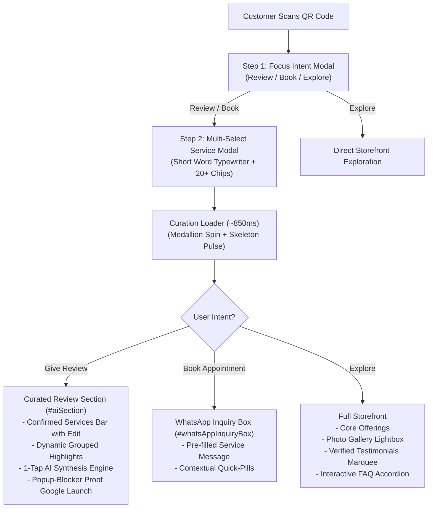
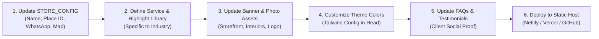

# OneScan360 — Architecture & Replication Blueprint

This document provides a comprehensive, ground-up architectural overview of the **OneScan360 Adaptive Experience & Review Engine** built for **THE UNISEX SALON**. It serves as an exact reference manual so you can duplicate, customize, and deploy this system for any other business (e.g., Dental Clinic, Gym, Restaurant, Car Detailer, Boutique, Cafe, etc.).

---

## 1. Executive Summary & Core Concept

### The Problem
Traditional business QR codes either:
1. Dump the user onto a generic Google Maps page with an empty text box (resulting in customer laziness, blank reviews, or drop-off).
2. Point to a static link tree or website with too much friction, requiring typing and manual searching.

### The OneScan360 Solution
OneScan360 converts a single in-store QR scan (counter, mirror, invoice, or WiFi login) into a **dynamic, intent-driven customer journey**:
- **Immediate Focus (Step 1)**: Asks what the customer wants to do (`Give Review`, `Book Appointment`, `Explore`).
- **Zero-Typing Multi-Service Picker (Step 2)**: Customers tap services they had/want with checkmarks (`✓`) and animated search assistance.
- **Micro-Interaction Transition**: A custom scissors & comb spinning animation + skeleton breathing pulse provides smooth feedback while the page adapts.
- **Adaptive Review Draft Engine**: Eliminates customer friction by dynamically grouping highlights *only* for the services they confirmed, plus universal qualities. A single tap generates an authentic, human-sounding review draft (English/Hinglish) with copy-and-open Google Review functionality that never triggers popup blockers.
- **Adaptive WhatsApp Booking**: Direct pre-filled WhatsApp booking links matching their exact service query.



---

## 2. System Architecture & Tech Stack

### Tech Stack
- **Structure**: Single-file HTML5 architecture (`index.html`) optimized for zero-build static hosting (Netlify, Vercel, GitHub Pages, Apache, or Nginx).
- **Styling**: Tailwind CSS via CDN with customized design tokens.
- **Icons & Typography**: Standard UTF-8 Emojis + inline SVG vector icons + Google Fonts (`Cinzel` for luxury serif accents, `Plus Jakarta Sans` for clean modern body text).
- **Script Runtime**: Pure Vanilla JavaScript (ES6+), zero external runtime dependencies, ultra-lightweight (<120 KB total payload before image caching).

### Design Tokens & Visual Hierarchy
The system uses an **Ivory, Charcoal & Champagne Gold** luxury color palette:

| Token Name | Hex Code | Purpose |
| :--- | :--- | :--- |
| `ivory` | `#FAF9F7` | Soft, elegant background base |
| `charcoal` | `#292929` | High-contrast headers and dark primary buttons |
| `charcoal-deep` | `#1A1A1A` | Modal backdrop overlay and deep text |
| `gold` | `#D7B27A` | Accent borders, stars, active badges |
| `gold-pale` | `#FBF6EE` | Selected chip backgrounds, subtle containers |
| `gold-deep` | `#B88E4C` | High-legibility text on gold backgrounds |
| `champagne` | `#EAE4DA` | Soft divider borders and chip outlines |
| `champagne-light`| `#F4F0EA` | Subtle card fills and pill backgrounds |

---

## 3. Step-by-Step User Journey & Component Breakdown

### Step 1: Initial Intent Focus Modal (`#entryFocusModal`)
- **Trigger**: Appears on initial page load if no prior session exists.
- **Functionality**: Presents 3 large, tappable action cards:
  1. `⭐ Give a Review` (Sets intent to `REVIEW`)
  2. `📅 Book an Appointment` (Sets intent to `BOOK`)
  3. `🌟 Explore Business` (Bypasses onboarding to browse storefront)
- **DOM Container**: `<div id="entryFocusModal">`
- **Handler**: `selectInitialIntent(intent)`

### Step 2: Multi-Select Service Selector (`#entryServiceModal`)
- **Dynamic Context Header**:
  - In Review Mode: `What services did you get? ✂️`
  - In Booking Mode: `What services are you booking? ✂️`
  - Includes a `← Back` button to return to Step 1.
- **Short 1–3 Word Phrase Typewriter**:
  - Cycles short keywords in placeholder (`"Haircut"`, `"Facial"`, `"Waxing"`, `"Hair Spa"`, etc.).
  - Stops immediately when customer taps or focuses.
- **Multi-Service Search Box**:
  - Typing a service and pressing <kbd>Enter</kbd> or tapping the inline `➔` button adds it to `confirmedServicesList`.
  - Clears input automatically to invite additional services.
- **Active Services Tray (`#modalSelectedTray`)**:
  - Shows pills for all currently selected services with `✓` badges and `✕` remove buttons.
  - Includes a `Clear All` button.
- **Filterable Category Chips Grid (`#modalPlentyChipsGrid`)**:
  - Category tabs: `[All]`, `[Hair]`, `[Beauty]`, `[Skin]`, `[Nails]`.
  - Multi-select chips with toggle functionality (select/deselect).
  - Selected state: `is-active-service` with `✓` checkmark and gold border.
- **Dynamic Continue Button**:
  - 0 services: `Continue to Salon ➔`
  - 1 service: `Continue with Facial ➔`
  - Multiple services: `Continue with 3 Services ➔`

### Step 3: Scissor & Comb Animation Loader (`#salonCuratingLoader`)
- **Visuals**: Rotating golden orbit + medallion with scissors & comb (`✂️ 💈`) + skeleton breathing card pulse.
- **Timing**: 850ms deliberate transition.
- **Dynamic Label**: Displays `"Curating [Service A, Service B] highlights for you..."`.
- **Purpose**: Creates psychological satisfaction that the app is actively customizing the page for their specific visit.

### Step 4: Curated Review Engine (`#aiSection`)
This section completely eliminates customer drop-off by removing the need to type:
1. **Confirmed Services Bar (`#confirmedServicesBar`)**:
   - Displays pills for confirmed services: `[✓ Facial]`, `[✓ Waxing]`, `[✓ Threading]`.
   - **Never asks for services again**.
   - Includes `✏️ Edit` button to modify services without losing review progress.
2. **Optional Customer Notes (`#reviewCustomerNotes`)**:
   - Optional multiline textarea for personal thoughts.
   - Live word counter (`X words`).
   - If left empty, AI generates the review entirely from highlight selections.
3. **Dynamic Grouped Highlights (`#dynamicGroupedHighlightsContainer`)**:
   - Generates distinct cards *only* for the confirmed services (from `SERVICE_HIGHLIGHT_LIBRARY`).
   - Unrelated services (e.g. Hair Colour when only Facial was picked) are completely excluded.
   - Shows top 5–6 chips initially with a `+ Show more` / `− Show less` toggle.
   - Selected chips are **always preserved** in view even when collapsed.
   - Always includes universal qualities (`🤝 Overall Visit`: Friendly Staff, Clean & Hygienic, Value for Money, etc.).
4. **Length & Language Selectors**:
   - Responsive 2-column grid (`grid grid-cols-1 sm:grid-cols-2`).
   - Length: `Short` (Default, 15–25 words), `Balanced` (35–50 words), `Detailed` (60–80 words).
   - Language: `English`, `Hinglish`.
5. **Review Draft Card (`#reviewOutputCard`)**:
   - **Typewriter Animation**: Types character-by-character with a pulsating gold cursor (`typeReviewText`).
   - **Rephrase Button**: `🔄 Rephrase` generates new variations with the animated typewriter effect.
   - **Smooth Auto-Scroll**: Clicking `Help Me Write Review ➔` smoothly scrolls the page so the draft lands directly at the top of the viewport with a temporary focus ring.

### Step 5: Popup-Blocker Proof Google Redirection (`copyAndRedirectReview`)
Modern mobile and desktop browsers block `window.open()` if it is delayed inside `setTimeout` or asynchronous promises. OneScan360 solves this with a multi-tiered architecture:
1. **Synchronous User-Gesture Navigation**: `window.open(reviewUrl, '_blank', 'noopener,noreferrer')` executes synchronously within the click event loop.
2. **Dual-Layer Clipboard Copying**:
   - Tries modern `navigator.clipboard.writeText(textToCopy)`.
   - Automatically falls back to a hidden `document.execCommand('copy')` on older devices/iframes.
3. **Direct Navigation Fallback**: If a browser's strict settings block the new tab, `window.location.href = reviewUrl` automatically navigates directly to Google Reviews.

---

## 4. Key JavaScript Data Structures & Engines

### 1. Store Configuration (`STORE_CONFIG`)
The central source of truth for merchant branding, URLs, and contact info:

```javascript
const STORE_CONFIG = window.STORE_CONFIG = {
    id: "the-unisex-salon",
    name: "THE UNISEX SALON",
    shortName: "The Unisex Salon",
    tagline: "Look Good. Feel Confident.",
    categorySubtitle: "Hair, Beauty, Skin & Nails Studio",
    address: "140, Post Office Rd, near Char Khamba, Clement Town, Dehradun, 248002",
    contact: {
        phone: "+918755527539",
        phoneDisplay: "87555 27539",
        whatsapp: "918755527539",
        mapsUrl: "https://www.google.com/maps?cid=9438144801872518145"
    },
    reviews: {
        writeReviewUrl: "https://search.google.com/local/writereview?placeid=ChIJhWsCLwArCTkRAZxPHrEG-4I",
        rating: 4.9,
        count: "500+"
    },
    links: {
        googleReviewUrl: "https://search.google.com/local/writereview?placeid=ChIJhWsCLwArCTkRAZxPHrEG-4I",
        googleMapsUrl: "https://www.google.com/maps?cid=9438144801872518145",
        instagramUrl: "https://www.instagram.com/the_unisexsalon/"
    },
    rating: 4.9,
    hours: "Monday – Sunday: 8:00 AM – 10:00 PM"
};
```

### 2. Service Highlight Library (`SERVICE_HIGHLIGHT_LIBRARY`)
Maps any service name or alias to curated, realistic highlight chips:

```javascript
const SERVICE_HIGHLIGHT_LIBRARY = {
    "Haircut": {
        category: "HAIR",
        icon: "✂️",
        title: "Haircut Experience",
        highlights: [
            "Loved the Final Look",
            "Stylist Understood My Preference",
            "Precise Cutting",
            "Great Styling",
            "Attention to Detail",
            "Fresh New Look",
            "Professional Stylist"
        ]
    },
    "Facial": {
        category: "SKIN",
        icon: "🌸",
        title: "Facial Experience",
        aliases: ["Hydrating Facial", "Classic Facial", "Gold Facial"],
        highlights: [
            "Relaxing Treatment",
            "Skin Felt Refreshed",
            "Skin Felt Hydrated",
            "Gentle on Skin",
            "Visible Glow",
            "Comfortable Face Massage",
            "Great Product Quality"
        ]
    },
    "Waxing": {
        category: "BEAUTY",
        icon: "🌿",
        title: "Waxing Experience",
        aliases: ["Full Body Waxing", "Rica Waxing"],
        highlights: [
            "Gentle Waxing",
            "Smooth Finish",
            "Minimal Discomfort",
            "Careful Technique",
            "Quick & Efficient",
            "Clean Equipment"
        ]
    }
    // ... Additional services (Hair Spa, Keratin, Nails, Makeup, etc.)
};

const UNIVERSAL_HIGHLIGHTS = [
    { name: "Friendly Staff", icon: "🤝" },
    { name: "Clean & Hygienic", icon: "🫧" },
    { name: "Comfortable Atmosphere", icon: "✨" },
    { name: "Good Value", icon: "💰" },
    { name: "Professional Service", icon: "⭐" },
    { name: "Timely Service", icon: "⏱️" },
    { name: "Personal Attention", icon: "👁️" },
    { name: "Loved the Results", icon: "🌟" },
    { name: "Would Visit Again", icon: "🔄" },
    { name: "Would Recommend", icon: "💖" }
];
```

### 3. AI Review Synthesis Engine (`REVIEW_AI_ENGINE`)
Takes the confirmed services, selected highlights, optional customer notes, length, and language, then synthesizes a natural review:

```javascript
const REVIEW_AI_ENGINE = {
    generate(lang = 'ENGLISH', length = 'SHORT') {
        const confirmed = confirmedServicesList.length > 0 ? confirmedServicesList : ["Hair Spa"];
        const customerNotes = customerWrittenReviewNotes;

        const detailsByGroup = {};
        for (const [groupKey, list] of Object.entries(selectedHighlightsMap)) {
            if (list && list.length > 0) detailsByGroup[groupKey] = list;
        }

        const ctx = {
            services: confirmed,
            servicesText: formatServicesListText(confirmed),
            detailsByGroup,
            customerNotes,
            length,
            lang
        };

        return lang === 'HINGLISH' ? this.synthesizeHinglish(ctx) : this.synthesizeEnglish(ctx);
    },

    synthesizeEnglish(ctx) {
        // Short: 1-2 punchy sentences (15-25 words)
        if (ctx.length === 'SHORT') {
            if (ctx.customerNotes && ctx.customerNotes.trim().length > 0) {
                const cleanNotes = ctx.customerNotes.trim();
                const formatted = /[.!?]$/.test(cleanNotes) ? cleanNotes : cleanNotes + '.';
                return `${formatted} Loved my visit for ${ctx.servicesText} at ${STORE_CONFIG.name}. Highly recommended!`;
            }

            const firstGroupKey = Object.keys(ctx.detailsByGroup).find(k => k !== 'overall');
            let highlightSnippet = '';
            if (firstGroupKey && ctx.detailsByGroup[firstGroupKey]?.length > 0) {
                highlightSnippet = `, especially the ${ctx.detailsByGroup[firstGroupKey][0].toLowerCase()}`;
            }

            const shortOpenings = [
                `Great experience getting ${ctx.servicesText} done at ${STORE_CONFIG.name}${highlightSnippet}! Clean space and polite staff. Highly recommend!`,
                `Loved my ${ctx.servicesText} at ${STORE_CONFIG.name}${highlightSnippet}! Super friendly team and great results. 5/5 stars!`,
                `Visited ${STORE_CONFIG.name} for ${ctx.servicesText} and had a fantastic time${highlightSnippet}. Definitely recommended!`
            ];
            return shortOpenings[Math.floor(Math.random() * shortOpenings.length)];
        }

        // Balanced & Detailed synthesis...
    }
};
```

---

## 5. How to Replicate for Any Other Business (Step-by-Step)

To adapt this codebase for a new client or business type, follow this checklist:



### Step 1: Update `STORE_CONFIG`
In `index.html`, update the configuration block:
- `name`: Business Name.
- `address`: Full physical address.
- `contact.phone` / `contact.whatsapp`: Phone number with country code.
- `reviews.writeReviewUrl`: Google Review URL format:  
  `https://search.google.com/local/writereview?placeid=<YOUR_GOOGLE_PLACE_ID>`
  *(Get Place ID from Google Place ID Finder)*
- `contact.mapsUrl`: Google Maps listing URL or CID:  
  `https://www.google.com/maps?cid=<YOUR_CID>`

### Step 2: Swap the Service & Highlight Library
Replace `PLENTY_SERVICES_LIST` and `SERVICE_HIGHLIGHT_LIBRARY` with terms specific to the new business:

#### Example: Dental Clinic
- **Services**: `Dental Cleaning`, `Teeth Whitening`, `Root Canal`, `Dental Braces`, `Tooth Extraction`.
- **Highlights**:
  - `Dental Cleaning`: `Gentle Cleaning`, `Painless Treatment`, `Teeth Felt Fresh`, `Thorough Examination`.
  - `Teeth Whitening`: `Noticeable Brightness`, `Natural-Looking Smile`, `Comfortable Procedure`.
  - `Universal Overall`: `Dr. Explained Everything Clearly`, `Zero Wait Time`, `Spotless Clinic`, `Compassionate Staff`.

#### Example: Automobile Workshop / Detailing Studio
- **Services**: `Ceramic Coating`, `Interior Deep Clean`, `Periodic Oil Service`, `Brake Inspection`, `Paint Correction`.
- **Highlights**:
  - `Ceramic Coating`: `Deep Mirror Gloss`, `Flawless Paint Finish`, `Attention to Edges`.
  - `Interior Deep Clean`: `Odor Free`, `Stain Removal`, `Clean AC Vents`.
  - `Universal Overall`: `Transparent Billing`, `Timely Delivery`, `Genuine Parts Used`.

#### Example: Cafe & Bakery
- **Services**: `Specialty Pour-Over`, `Artisan Sourdough`, `Pastries & Croissants`, `Breakfast Platter`.
- **Highlights**:
  - `Specialty Pour-Over`: `Rich Aroma`, `Perfect Brewing`, `High Quality Beans`.
  - `Pastries`: `Flaky & Fresh`, `Authentic Flavor`, `Great Presentation`.
  - `Universal Overall`: `Cozy Ambiance`, `Fast Wi-Fi`, `Warm Hospitality`.

### Step 3: Swap Assets
Replace the image files in `assets/images/`:
- `hero-storefront.jpg`: Storefront exterior banner (4:3 aspect ratio recommended).
- `profile-logo.jpg`: Square business avatar/logo.
- `gallery-*.jpg`: 4–8 photos of the interior, equipment, and work.

### Step 4: Customize Theme Colors (Optional)
In the `<head>` of `index.html`, adjust the `tailwind.config` color tokens to match the client's branding:
```javascript
tailwind.config = {
    theme: {
        extend: {
            colors: {
                // e.g. For a Dental Clinic (Medical Teal & Slate):
                ivory: '#F8FAFC',
                charcoal: '#0F172A',
                gold: '#0EA5E9',
                'gold-pale': '#F0F9FF',
                'gold-deep': '#0369A1'
            }
        }
    }
};
```

### Step 5: Testimonials & FAQs
Update `TESTIMONIALS` and `FAQS` arrays in `index.html` with real customer feedback and common operational questions (parking, walk-in policy, payments).

### Step 6: Deploy & Generate QR Code
1. Push to GitHub repository.
2. Deploy to Netlify / Vercel with 1 click (or run `npx serve . -l 3000`).
3. Generate a high-resolution QR code pointing to the live URL and place it in the store!

---

## 6. Architecture Verification Checklist

When building or testing any replica of this project, verify these critical checkpoints:

- [x] **No Popup Blocking**: Verify that clicking `Copy & Open Google Review` opens Google immediately without browser warnings.
- [x] **Clipboard Reliability**: Verify that review text pastes cleanly into Google's review box.
- [x] **Zero Redundant Questions**: Confirmed services from onboarding must never appear as selection options in the review section.
- [x] **Dynamic Grouping**: Only highlights belonging to the confirmed services (plus universal visit) must be displayed.
- [x] **Short Review Brevity**: In `Short` mode, generated review must stay under 25 words.
- [x] **Smooth Scroll Placement**: Clicking `Help Me Write Review` must position the review draft card right at the top of the screen.
- [x] **Responsive Controls**: Length and Language pill controls must never overflow on mobile viewports (360px+).
- [x] **Accordion & Marquee**: FAQ items must toggle cleanly and client testimonials marquee must scroll seamlessly.

